# 🩺 CarePulse: Doctor Appointment Booking Portal

A **Power Apps Canvas app on Microsoft Dataverse** that digitizes clinic appointment booking from first call to consultation. Receptionists, Doctors and Clinic Admins each land on their own screen at launch, and a **Power Automate** flow emails the patient a branded booking card the moment an appointment is created.

   

> 🔗 **Live project page:** https://javedmcs83-ali.github.io/REPO-NAME/ *(replace `REPO-NAME` after enabling GitHub Pages)*

## 🎯 Problem
- Appointments were noted from calls and walk-ins in separate sheets, with no single source of truth
- Reception, doctors and admins needed different views of the same data
- Patients got no written confirmation of date, slot, doctor and appointment ID
- Doctor specialty, OPD room and fee were not available where bookings were made

## 👥 Roles
| Role | Start screen | What they do |
|---|---|---|
| Receptionist | `Scr_Patient_Bookings` | Search, create and edit appointments; print confirmation card |
| Doctor | `Scr_Doctor_Consulation` | View appointments by date, update status, record notes |
| Clinic Admin | `Scr_Clinic_Admin` | Manage Doctors Directory; jump to bookings and consultations |
| Patient | (no app access) | Receives the confirmation email |

## 🗂️ Dataverse tables
- **Tbl_User_Roles**: maps user email to role (drives start screen)
- **Tbl_Appointment**: 11 columns; patient, specialty, doctor, date, time slot, reason, status, consultation notes
- **Tbl_Doctors_Directory**: 5 columns; doctor ID, name, specialty, fee, OPD room

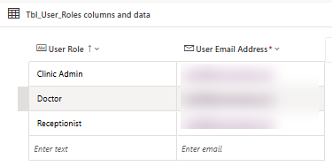

## 🔐 Role-based start screen routing
```powerfx
// App.Formulas
Var_Logged_User_Role = LookUp(
    Tbl_User_Roles,
    Lower('User Email Address') = Lower(User().Email)
).'User Role';

// App.StartScreen
Switch(Var_Logged_User_Role,
    "Receptionist", Scr_Patient_Bookings,
    "Doctor", Scr_Doctor_Consulation,
    "Clinic Admin", Scr_Clinic_Admin
)
```

## 📱 Canvas screens
> Screenshots use sample test data from a personal Microsoft tenant. Names and phone numbers are not real; email addresses are blurred.

**1. Clinic Admin: Doctors Directory**
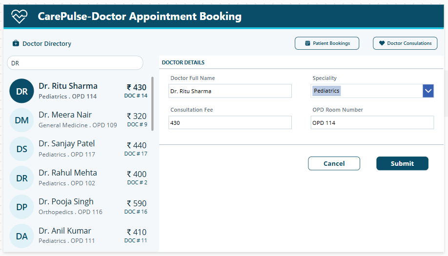

**2. Patient Bookings: gallery and form**
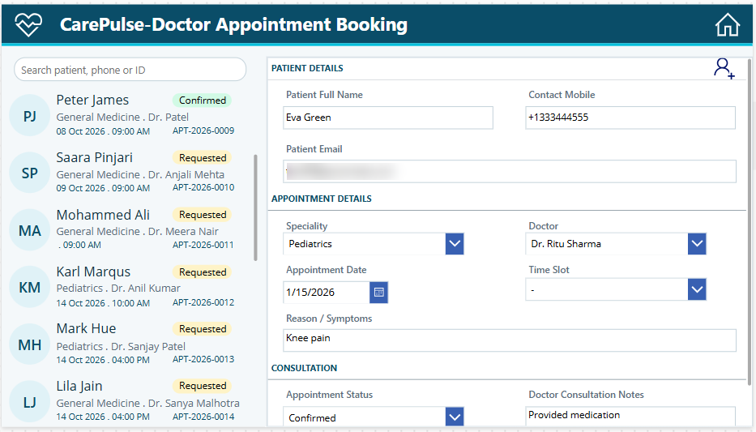
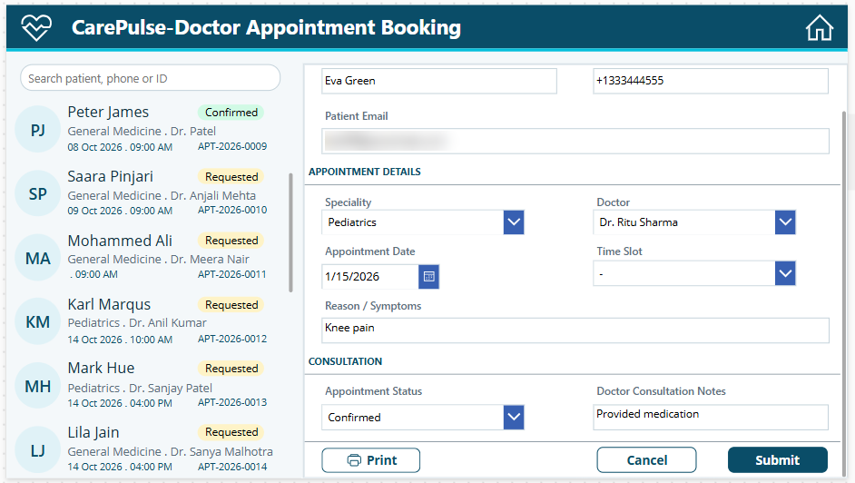

**3. Appointment Confirmation: printable HTML card**
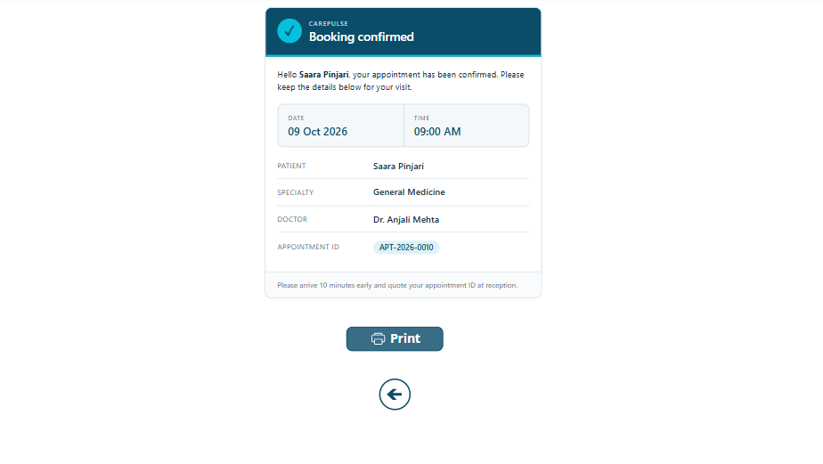

**4. Doctor Consultation**
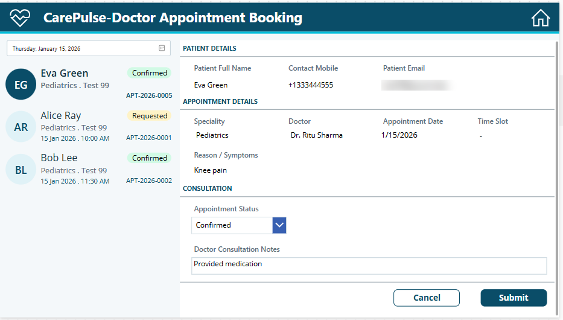

## ⚡ Power Automate: "CarePulse - Appointment Created"
Dataverse *row added* trigger → **TimeSlotMap** compose (choice number to readable time) → **Send an email (V2)** with an HTML card to the patient.

| Trigger | TimeSlotMap |
|---|---|
| 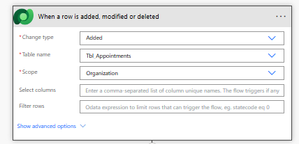 | 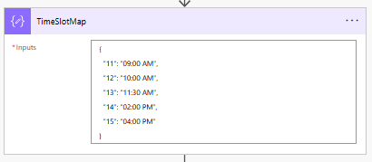 |

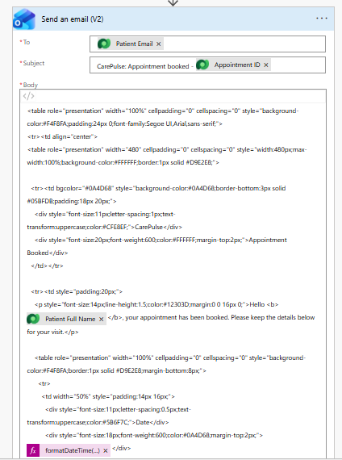 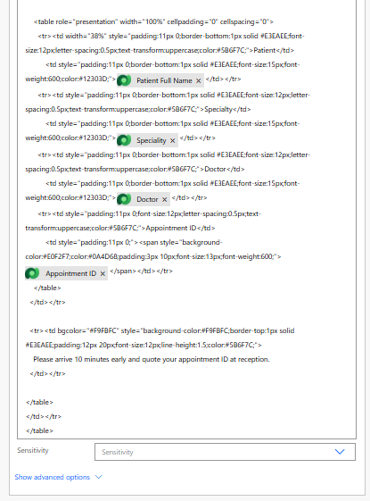

**Email received by the patient in Outlook**
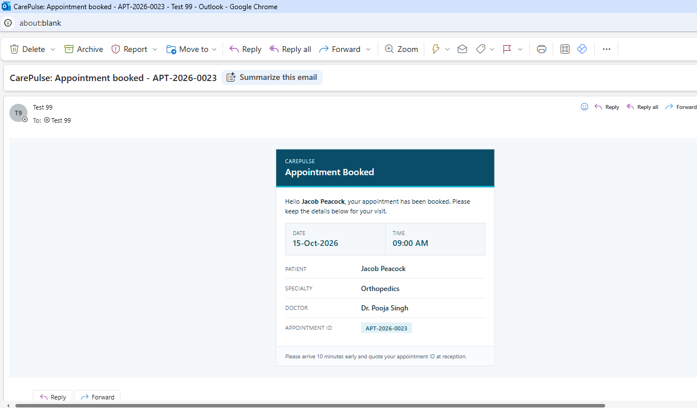

## 🛠️ Tech stack
Power Apps Canvas · Microsoft Dataverse · Power Automate · Office 365 Outlook · Solutions · Power Fx

## 📈 Delivered
3 Dataverse tables · 4 canvas screens · 3 roles with automatic routing · 5 bookable time slots · 4 appointment statuses · 1 automated confirmation-email flow

## 👤 Author
**Javed Pinjari**: Power Platform Developer · [LinkedIn](https://www.linkedin.com/in/javed-pinjari-0a176582/) · [GitHub](https://github.com/javedmcs83-ali)

*Personal learning project using synthetic data. Not affiliated with or endorsed by any employer or client.*
